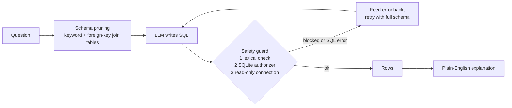

# text2sql-agent

A **self-correcting, read-only text-to-SQL agent**. Ask a question in plain English; the agent picks the relevant tables, writes SQLite, runs it safely, reads any error and fixes its own query, then explains the answer.

It ships with a **reproducible benchmark** that measures *execution accuracy* (does the generated query return the same rows as a hand-written gold query?) and shows what each feature adds.

 **Results:** 96.7% (29/30) execution accuracy on a 30-question benchmark over a sample e-commerce database, using `openai/gpt-oss-120b` via Groq. See below for details and limitations.

## Architecture



| Feature | Where | Why it matters |
|---|---|---|
| Schema pruning | `schema.py` | Smaller prompts on big databases; falls back to the full schema on a retry in case a needed table was dropped |
| Self-correction loop | `agent.py` | Database error messages are returned to the model, up to 3 retries |
| 3-layer read-only guard | `guard.py`, `db.py` | Single `SELECT`/`WITH` only (comments and string literals are handled), SQLite authorizer denies all writes, connection opened `mode=ro`. Plus a query timeout and row cap |
| Provider-agnostic LLM layer | `llm.py` | Anthropic, OpenAI, Groq or Gemini; retries with backoff |
| Benchmark runner | `benchmark/` | Compares **baseline** vs **+ self-correction** vs **+ pruning** |
| Tests with a scripted fake LLM | `tests/` | 43 tests, no API key needed, run in CI |

## Quickstart

```bash
git clone https://github.com/<you>/text2sql-agent && cd text2sql-agent
python -m venv .venv && source .venv/bin/activate      # Windows: .venv\Scripts\activate
pip install -e ".[app,dev]"
cp .env.example .env     # add ONE API key, then load it (or export the variable in your shell)
```

```bash
# CLI (builds the sample shop database on first run)
python -m text2sql "Which product category generated the most revenue from delivered orders?" --explain

# Web demo
streamlit run app.py
```

Free-tier option: set `GROQ_API_KEY` or `GEMINI_API_KEY` and pass `--provider groq` (or `gemini`). Default model names live in `llm.py` and change often, so override with `--model` if one is retired.

## Run the benchmark

Two datasets are supported.

**1. Bundled shop database (30 questions: 10 easy, 11 medium, 9 hard).** Gold queries are hand-written and checked for unambiguous answers (no ties in any "top 1" question).

```bash
python benchmark/run_benchmark.py --provider anthropic
```

**2. Spider (recommended for the headline number).** Download [Spider](https://yale-lily.github.io/spider) yourself, extract it to `data/spider/` (it must contain `dev.json` and `database/`), then:

```bash
python benchmark/run_benchmark.py --spider-dir data/spider --limit 100 --provider anthropic
```

Results are written to `benchmark/results/results.md` and `results.json` (per-question SQL, errors, attempts, latency). **Commit `results.md` and paste the table here**, so visitors can see real numbers:

| Mode | Accuracy | Valid SQL | Avg attempts |
|---|---|---|---|
| baseline (one shot, full schema) | 96.7% (29/30) | 100% | 1.00 |
| + self-correction | 96.7% (29/30) | 100% | 1.00 |
| + schema pruning (full agent) | 96.7% (29/30) | 100% | 1.00 |

**Notes on these results**

- The single miss (question m05, "average rating for each product") is an ambiguous question: the model used a LEFT JOIN and listed a product that has no reviews, while the reference query used an inner join. Both readings are defensible, and the question was left unchanged.
- All three modes scored the same, and no query needed a retry, so on this small benchmark the strong model never made an error for self-correction to fix. The benchmark shows that the agent works, not that self-correction or pruning improve accuracy.

Self-check without an API key: `python benchmark/run_benchmark.py --oracle` replays the gold SQL through the whole pipeline and must score 100%. CI runs this on every push, so a broken harness is caught early.

### How accuracy is scored

Execution accuracy compares result **rows**, not SQL text, so different but equivalent queries count as correct. Numbers are compared to 2 decimals, row order is ignored unless the gold query has `ORDER BY`, duplicates matter, and column names are ignored. This is a simplified version of the official Spider metric, so quote your numbers as *"execution accuracy on a 100-question Spider dev subset, using this repo's scorer"*, not as an official leaderboard score.

## Project layout

```
src/text2sql/   guard.py  db.py  schema.py  llm.py  agent.py  evaluation.py  sample_db.py  cli.py
benchmark/      run_benchmark.py  shop_questions.json
tests/          guard, agent (self-correction, pruning), scoring, gold-query checks
app.py          Streamlit demo
```

## Limitations

- SQLite only. Other databases need a different driver and guard.
- Pruning is keyword-based, with no embeddings, and may miss tables whose names share no words with the question. The retry then shows the full schema.
- Execution accuracy cannot tell whether a query answers an ambiguous question the way a person intended.
- The lexical guard forbids some keywords anywhere in a query (for example a column literally named `update`). Quote such identifiers.

## License

MIT
